# How Jev Comment Triage works

These diagrams describe the **current implementation**, not a proposed design.
The plugin source snapshot is
[`f387f158148e3451082021c601fc88b84411137a`](https://github.com/soderlind/jev-comment-triage/tree/f387f158148e3451082021c601fc88b84411137a);
the illustrated guide and README correction are subsequent worktree changes.
The separately maintained AI Provider for Jev was checked at
[`d0ece3119be459398d991da4a39926b6b7ce1656`](https://github.com/soderlind/ai-provider-for-jev/tree/d0ece3119be459398d991da4a39926b6b7ce1656).
An installed provider may differ from that revision.

The SVGs are the canonical PR Lens output; PNGs are static 2x companions.
Sequence diagrams read from top to bottom; dashed arrows represent returns.
Decision thresholds and batch sizes are defaults and can be changed through
the plugin's filters.

## System overview

WordPress holds eligible comments and marks them pending. WP-Cron drains the
oldest pending comments, the processor groups them by post, and the assessment
module asks the Jev provider for judgments. The processor applies the policy
and stores the result and status. The cache is used in shadow mode by default.

<!-- Theme-aware images use picture elements to select the reader's color scheme. -->
<!-- markdownlint-disable MD033 -->

<picture>
  <source media="(prefers-color-scheme: dark)" srcset="rendered/system-overview-dark.svg">
  
</picture>

[Light SVG](rendered/system-overview-light.svg) |
[Dark SVG](rendered/system-overview-dark.svg) |
[Light PNG](rendered/system-overview-light.png) |
[Dark PNG](rendered/system-overview-dark.png)

## Decision policy

The first matching rule wins: spam at or above 0.90 becomes spam; otherwise
abuse at or above 0.50 is held. An on-topic judgment with confidence at least
0.80 and both spam and abuse below 0.20 retains WordPress's original decision.
Everything else is held. A clean judgment therefore does not override an
original WordPress hold.

<picture>
  <source media="(prefers-color-scheme: dark)" srcset="rendered/decision-policy-dark.svg">
  
</picture>

[Light SVG](rendered/decision-policy-light.svg) |
[Dark SVG](rendered/decision-policy-dark.svg) |
[Light PNG](rendered/decision-policy-light.png) |
[Dark PNG](rendered/decision-policy-dark.png)

## Eligible submission

For an eligible regular comment, intake remembers WordPress's original
decision, returns a hold, then records pending and base metadata after
insertion. It ensures a recurring drain is scheduled and may nudge WP-Cron
immediately; the author does not wait for the Jev assessment.

<picture>
  <source media="(prefers-color-scheme: dark)" srcset="rendered/submit-comment-dark.svg">
  
</picture>

[Light SVG](rendered/submit-comment-light.svg) |
[Dark SVG](rendered/submit-comment-dark.svg) |
[Light PNG](rendered/submit-comment-light.png) |
[Dark PNG](rendered/submit-comment-dark.png)

## Successful background assessment

A drain selects up to 20 held, pending, untriaged comments by default, oldest
first. The processor groups and chunks them by post. For comments taking the
Jev path, the request has one relevance, one spam, and one abuse question per
comment. The response is validated before policy is applied and the result
and status are written.

<picture>
  <source media="(prefers-color-scheme: dark)" srcset="rendered/background-success-dark.svg">
  
</picture>

[Light SVG](rendered/background-success-light.svg) |
[Dark SVG](rendered/background-success-dark.svg) |
[Light PNG](rendered/background-success-light.png) |
[Dark PNG](rendered/background-success-dark.png)

## Outage and retry

An outage or timeout is not split into smaller requests. A failed comment
remains pending for a later drain; after the third recorded failure, its
pending marker is removed and it is left for manual moderation. The second
attempt is omitted from this example. WordPress write results are not checked.

<picture>
  <source media="(prefers-color-scheme: dark)" srcset="rendered/outage-retry-dark.svg">
  
</picture>

[Light SVG](rendered/outage-retry-light.svg) |
[Dark SVG](rendered/outage-retry-dark.svg) |
[Light PNG](rendered/outage-retry-light.png) |
[Dark PNG](rendered/outage-retry-dark.png)

## Rejected request and split

For HTTP 413 or 422, a multi-comment request is recursively split in half.
This example shows a two-comment HTTP 422 response: the first individual
request succeeds and the second still fails, so their results are returned
separately. A single-comment rejection is not split further.

<picture>
  <source media="(prefers-color-scheme: dark)" srcset="rendered/split-rejected-request-dark.svg">
  
</picture>

<!-- markdownlint-enable MD033 -->

[Light SVG](rendered/split-rejected-request-light.svg) |
[Dark SVG](rendered/split-rejected-request-dark.svg) |
[Light PNG](rendered/split-rejected-request-light.png) |
[Dark PNG](rendered/split-rejected-request-dark.png)

## Source map

Every node, edge, and sequence message in [graph.json](graph.json) carries
repository-relative file and line references. The following groups map the
visible elements to their principal implementation evidence:

| Elements | Evidence |
| --- | --- |
| `author`, `comments`, `intake`, `cron`; `author-comments`, `comments-intake`, `intake-comments`, `intake-cron` | [Hook registration](../../jev-comment-triage.php#L75), [eligibility and defer](../../includes/intake.php#L65), [enqueue and scheduling](../../includes/intake.php#L130), [provider readiness and comment types](../../includes/core.php#L22) |
| `drain`, `processor`, `cache`; `cron-drain`, `drain-processor`, `processor-cache`, `processor-comments` | [Drain and query](../../includes/scheduler.php#L46), [group and process](../../includes/processor.php#L27), [cache use](../../includes/processor.php#L68), [cache keys and counters](../../includes/spam-cache.php#L17), [result writes](../../includes/processor.php#L172) |
| `assessment`, `jev-provider`, `jev-api`; `processor-assessment`, `assessment-provider`, `provider-api`, `assessment-processor` | [Assessment requests and parsing](../../includes/class-assessment.php#L46), [processor adapter](../../includes/processor.php#L27), [provider `evaluate()`](https://github.com/soderlind/ai-provider-for-jev/blob/d0ece3119be459398d991da4a39926b6b7ce1656/src/api.php#L28), [provider HTTP client](https://github.com/soderlind/ai-provider-for-jev/blob/d0ece3119be459398d991da4a39926b6b7ce1656/src/Client/JevClient.php#L43) |
| `policy`, `base`, `spam`, `held`, `approved`; `processor-policy`, `policy-spam`, `policy-held`, `policy-base`, `base-approved`, `base-held` | [Threshold defaults](../../jev-comment-triage.php#L36), [ordered decision policy](../../includes/policy.php#L42), [status mapping](../../includes/processor.php#L206) |
| `eligible-submission` sequence | [Defer and enqueue](../../includes/intake.php#L65), [hook registration](../../jev-comment-triage.php#L75) |
| `successful-assessment` sequence | [Drain](../../includes/scheduler.php#L46), [grouping and persistence](../../includes/processor.php#L27), [questions and validation](../../includes/class-assessment.php#L46), [provider helper](https://github.com/soderlind/ai-provider-for-jev/blob/d0ece3119be459398d991da4a39926b6b7ce1656/src/api.php#L28) and [HTTP client](https://github.com/soderlind/ai-provider-for-jev/blob/d0ece3119be459398d991da4a39926b6b7ce1656/src/Client/JevClient.php#L43) |
| `outage-retries` sequence | [No split for other errors](../../includes/class-assessment.php#L46), [failure counter and pending removal](../../includes/processor.php#L193), [retry limit](../../jev-comment-triage.php#L36) |
| `body-rejection` sequence | [Recursive split and result merge](../../includes/class-assessment.php#L46), [rejection status check](../../includes/class-assessment.php#L215), [assessment tests](../../tests/Unit/AssessmentTest.php) |

### Boundaries and caveats

- Intake bypasses triage when the provider is missing or unconfigured, for
  trusted moderators, non-regular comments, WordPress errors, and comments
  already marked spam or trash. See [eligibility](../../includes/intake.php#L65).
- Empty comments, an enabled minimum-word rule, or an explicitly enabled spam
  cache may bypass the Jev call. The default cache performs shadow lookups;
  it does not decide the comment. See [processing](../../includes/processor.php#L68).
- A Jev request includes the post title and content plus each comment's
  content and link count; by default it also includes the author's name, URL,
  and email. The `jct_include_author_details` filter can remove those author
  fields. See [payload construction](../../includes/core.php#L49).
- The provider sends `POST /systemone` to its configured endpoint. The diagram
  does not imply a particular endpoint configuration or model version.
- The transient lock's check and set are separate operations, so it only
  reduces overlap; it does not guarantee exclusive or exactly-once processing.
  Metadata and status writes are neither transactional nor checked. The retry
  diagram assumes the selected comment is not independently changed by
  another actor. WP-Cron timing depends on the site's cron configuration.

## Reproduce and validate

The following commands run from the repository root. They require Node.js
20.11 or newer, npm, and `rsvg-convert` (librsvg). The checked output was
generated with Node.js 26.13.1, npm 11.20.0, and rsvg-convert 2.63.4.
`mktemp` gives the renderer a fresh directory; it refuses to overwrite SVGs.

```sh
cd docs/diagrams
npm ci
out=$(mktemp -d)
node check-contrast.mjs --palette github
node render.mjs graph.json "$out" --palette github
for svg in "$out"/*.svg; do
  rsvg-convert -z 2 -o "${svg%.svg}.png" "$svg"
done
node check-contrast.mjs --palette github --svg "$out"
printf 'Rendered diagrams: %s\n' "$out"
```

The approved **GitHub** palette passes the check's required text and graphic
pairs in both themes for this unchanged snapshot. The checker also reports
warnings for change-diagram-only colors, which these views do not use: light
removed-card title/subtitle at 2.72:1 and 2.79:1; dark removed badge at 4.23:1
and removed-card title/subtitle at 3.41:1. See the complete
[contrast results](contrast-results.txt). These renderer palette limitations
are suitable for an upstream report.

Relevant unit tests passed: 55 tests, 101 assertions. Run them from the
repository root with:

```sh
vendor/bin/pest tests/Unit/LogicTest.php tests/Unit/AssessmentTest.php tests/Unit/DeferTest.php tests/Unit/ProcessCommentTest.php
```
