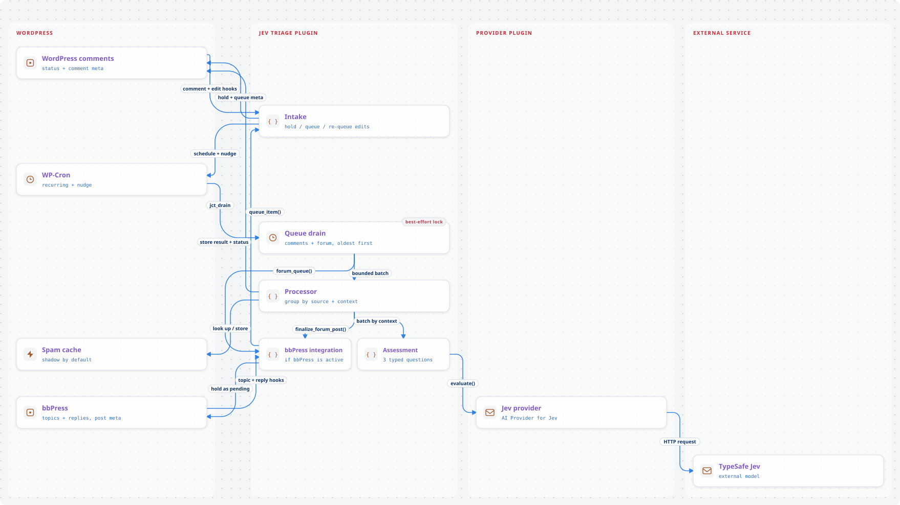
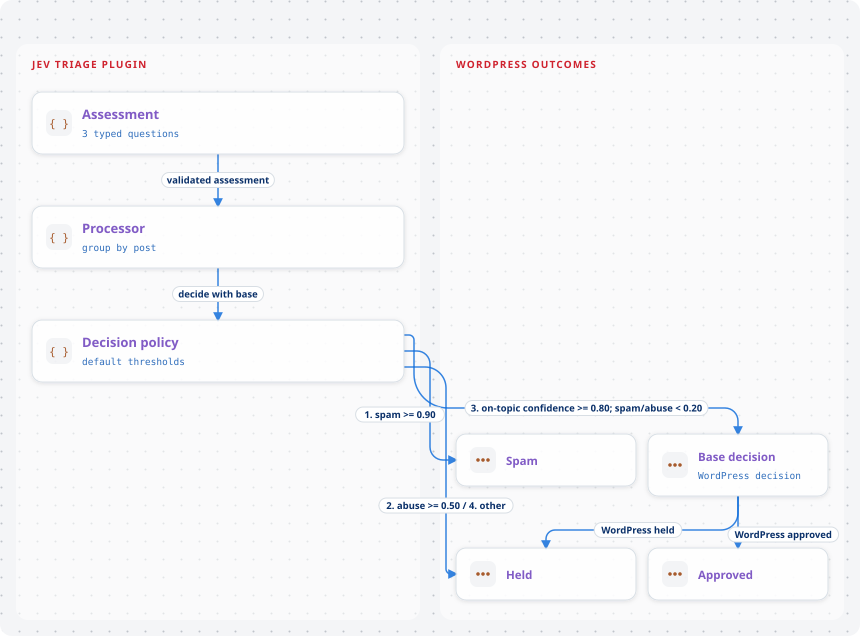

# How Jev Comment Triage works

These diagrams describe the **current implementation**, not a proposed design.
They show comments and bbPress topics and replies, including edits. The
evidence is the working tree on top of
[`d79dfbe`](https://github.com/soderlind/jev-comment-triage/tree/d79dfbe), which
added bbPress support and edit re-triage; `graph.json` cites `d79dfbe` because
the schema needs a commit. Line references point at that working tree.
The separately maintained AI Provider for Jev was checked at
[`d0ece3119be459398d991da4a39926b6b7ce1656`](https://github.com/soderlind/ai-provider-for-jev/tree/d0ece3119be459398d991da4a39926b6b7ce1656).
An installed provider may differ from that revision.

The SVGs are the canonical PR Lens output; PNGs are static 2x companions.
Sequence diagrams read from top to bottom; dashed arrows represent returns.
Decision thresholds and batch sizes are defaults and can be changed through
the plugin's filters.

## System overview

WordPress holds eligible comments and marks them pending. When bbPress is
active, the bbPress integration does the same for topics and replies (as
`pending` posts with post meta). WP-Cron drains the oldest pending items from
both sources, the processor groups them by source and context, and the
assessment module asks the Jev provider for judgments. The processor applies
the policy and stores the result; comment status is set directly and forum
status through the bbPress integration. The spam cache is shared and used in
shadow mode by default.

<!-- Theme-aware images use picture elements to select the reader's color scheme. -->
<!-- markdownlint-disable MD033 -->

<picture>
  <source media="(prefers-color-scheme: dark)" srcset="rendered/system-overview-dark.svg">
  
</picture>

[Light SVG](rendered/system-overview-light.svg) |
[Dark SVG](rendered/system-overview-dark.svg) |
[Light PNG](rendered/system-overview-light.png) |
[Dark PNG](rendered/system-overview-dark.png)

## Decision policy

The first matching rule wins: spam at or above 0.90 becomes spam; otherwise
abuse at or above 0.50 is held. An on-topic judgment with confidence at least
0.80 and both spam and abuse below 0.20 retains WordPress's original decision.
Everything else is held. A clean judgment therefore does not override an
original WordPress or bbPress hold. For an edit, the base is the status before
the edit (or the stored base if the item is still queued), so an edit can never
publish a held item.

<picture>
  <source media="(prefers-color-scheme: dark)" srcset="rendered/decision-policy-dark.svg">
  
</picture>

[Light SVG](rendered/decision-policy-light.svg) |
[Dark SVG](rendered/decision-policy-dark.svg) |
[Light PNG](rendered/decision-policy-light.png) |
[Dark PNG](rendered/decision-policy-dark.png)

## Eligible submission

For an eligible regular comment, intake remembers WordPress's original
decision, returns a hold, then records pending and base metadata after
insertion. It ensures a recurring drain is scheduled and may nudge WP-Cron
immediately; the author does not wait for the Jev assessment.

<picture>
  <source media="(prefers-color-scheme: dark)" srcset="rendered/submit-comment-dark.svg">
  
</picture>

[Light SVG](rendered/submit-comment-light.svg) |
[Dark SVG](rendered/submit-comment-dark.svg) |
[Light PNG](rendered/submit-comment-light.png) |
[Dark PNG](rendered/submit-comment-dark.png)

## Forum topic or reply submission

bbPress first sets the status (Akismet and moderation keys may make it
`pending`). Running last on `bbp_new_{topic,reply}_pre_insert`, the bbPress
integration skips forum moderators and statuses other than `publish` and
`pending`, remembers the status as the base, and returns `pending`. After the
post is saved, `bbp_new_topic` or `bbp_new_reply` queues it with
`queue_item()`. Forum edits follow the same pattern on
`bbp_edit_{topic,reply}_pre_insert` and `bbp_edit_{topic,reply}`.

<picture>
  <source media="(prefers-color-scheme: dark)" srcset="rendered/submit-forum-post-dark.svg">
  
</picture>

[Light SVG](rendered/submit-forum-post-light.svg) |
[Dark SVG](rendered/submit-forum-post-dark.svg) |
[Light PNG](rendered/submit-forum-post-light.png) |
[Dark PNG](rendered/submit-forum-post-dark.png)

## Edited comment

When an untrusted editor changes a comment's text, `wp_update_comment_data`
holds it and records its base with `retriage_base()`. After the save,
`edit_comment` calls `queue_item()`, which removes the earlier result and
attempt count and queues the comment again. Edits by comment moderators,
edits of trusted authors' comments, and edits that do not change the text are
not triaged.

<picture>
  <source media="(prefers-color-scheme: dark)" srcset="rendered/edit-comment-dark.svg">
  
</picture>

[Light SVG](rendered/edit-comment-light.svg) |
[Dark SVG](rendered/edit-comment-dark.svg) |
[Light PNG](rendered/edit-comment-light.png) |
[Dark PNG](rendered/edit-comment-dark.png)

## Successful background assessment

A drain selects up to 20 held, pending, untriaged comments and up to 20 such
topics and replies by default, merges them oldest first, and keeps 20. The
processor groups and chunks them by source and context (a comment's post, a
topic's forum, or a reply's topic). For items taking the Jev path, the request
has one relevance, one spam, and one abuse question per item; the relevance
wording depends on the item type. The response is validated before policy is applied and the result
and status are written.

<picture>
  <source media="(prefers-color-scheme: dark)" srcset="rendered/background-success-dark.svg">
  
</picture>

[Light SVG](rendered/background-success-light.svg) |
[Dark SVG](rendered/background-success-dark.svg) |
[Light PNG](rendered/background-success-light.png) |
[Dark PNG](rendered/background-success-dark.png)

## Forum decision

For a topic or reply, the processor stores the result in post meta and calls
`finalize_forum_post()`, which uses `bbp_spam_*`, `bbp_approve_*`, or
`bbp_unapprove_*`. Before marking spam, it removes the bbPress Akismet
extension's `submit_post` listener and restores it afterwards, so automated
decisions are not reported to Akismet as a moderator's verdict. The processor
then fires `jct_triaged_forum_post`.

<picture>
  <source media="(prefers-color-scheme: dark)" srcset="rendered/forum-decision-dark.svg">
  
</picture>

[Light SVG](rendered/forum-decision-light.svg) |
[Dark SVG](rendered/forum-decision-dark.svg) |
[Light PNG](rendered/forum-decision-light.png) |
[Dark PNG](rendered/forum-decision-dark.png)

## Outage and retry

An outage or timeout is not split into smaller requests. A failed comment
remains pending for a later drain; after the third recorded failure, its
pending marker is removed and it is left for manual moderation. The second
attempt is omitted from this example. WordPress write results are not checked.

<picture>
  <source media="(prefers-color-scheme: dark)" srcset="rendered/outage-retry-dark.svg">
  
</picture>

[Light SVG](rendered/outage-retry-light.svg) |
[Dark SVG](rendered/outage-retry-dark.svg) |
[Light PNG](rendered/outage-retry-light.png) |
[Dark PNG](rendered/outage-retry-dark.png)

## Rejected request and split

For HTTP 413 or 422, a multi-comment request is recursively split in half.
This example shows a two-comment HTTP 422 response: the first individual
request succeeds and the second still fails, so their results are returned
separately. A single-comment rejection is not split further.

<picture>
  <source media="(prefers-color-scheme: dark)" srcset="rendered/split-rejected-request-dark.svg">
  
</picture>

<!-- markdownlint-enable MD033 -->

[Light SVG](rendered/split-rejected-request-light.svg) |
[Dark SVG](rendered/split-rejected-request-dark.svg) |
[Light PNG](rendered/split-rejected-request-light.png) |
[Dark PNG](rendered/split-rejected-request-dark.png)

## Source map

Every node, edge, and sequence message in [graph.json](graph.json) carries
repository-relative file and line references. The following groups map the
visible elements to their principal implementation evidence:

| Elements | Evidence |
| --- | --- |
| `author`, `comments`, `intake`, `cron`; `author-comments`, `comments-intake`, `intake-comments`, `intake-cron` | [Hook registration](../../jev-comment-triage.php#L75), [eligibility and defer](../../includes/intake.php#L65), [enqueue and scheduling](../../includes/intake.php#L133), [provider readiness and comment types](../../includes/core.php#L22) |
| `drain`, `processor`, `cache`; `cron-drain`, `drain-processor`, `processor-cache`, `processor-comments` | [Drain and query](../../includes/scheduler.php#L46), [group and process](../../includes/processor.php#L70), [cache use](../../includes/processor.php#L110), [cache keys and counters](../../includes/spam-cache.php#L17), [result writes](../../includes/processor.php#L209) |
| `assessment`, `jev-provider`, `jev-api`; `processor-assessment`, `assessment-provider`, `provider-api`, `assessment-processor` | [Assessment requests and parsing](../../includes/class-assessment.php#L79), [processor adapter](../../includes/processor.php#L70), [provider `evaluate()`](https://github.com/soderlind/ai-provider-for-jev/blob/d0ece3119be459398d991da4a39926b6b7ce1656/src/api.php#L28), [provider HTTP client](https://github.com/soderlind/ai-provider-for-jev/blob/d0ece3119be459398d991da4a39926b6b7ce1656/src/Client/JevClient.php#L43) |
| `policy`, `base`, `spam`, `held`, `approved`; `processor-policy`, `policy-spam`, `policy-held`, `policy-base`, `base-approved`, `base-held` | [Threshold defaults](../../jev-comment-triage.php#L34), [ordered decision policy](../../includes/policy.php#L42), [status mapping](../../includes/processor.php#L251) |
| `forum-author`, `bbpress`, `forum`; `forum-author-bbpress`, `bbpress-forum`, `forum-bbpress`, `forum-intake`, `drain-forum`, `processor-forum`, `forum-bbpress-status` | [bbPress hook registration](../../includes/bbpress.php#L26), [hold and queue](../../includes/bbpress.php#L101), [forum queue](../../includes/bbpress.php#L271), [finalize](../../includes/bbpress.php#L298), [shared `queue_item()`](../../includes/intake.php#L201) |
| `eligible-submission` sequence | [Defer and enqueue](../../includes/intake.php#L65), [hook registration](../../jev-comment-triage.php#L75) |
| `forum-submission` sequence | [Hold new forum post](../../includes/bbpress.php#L101), [queue new forum post](../../includes/bbpress.php#L128), [base from status](../../includes/bbpress.php#L84), [`queue_item()` and scheduling](../../includes/intake.php#L153) |
| `comment-edit` sequence | [Edit hooks](../../jev-comment-triage.php#L86), [hold edited comment](../../includes/intake.php#L222), [`retriage_base()`](../../includes/intake.php#L187), [queue edited comment](../../includes/intake.php#L261) |
| `forum-finalize` sequence | [Persist and finalize](../../includes/processor.php#L209), [bbPress moderation](../../includes/bbpress.php#L298), [Akismet pause](../../includes/bbpress.php#L321) |
| `successful-assessment` sequence | [Drain](../../includes/scheduler.php#L46), [grouping and persistence](../../includes/processor.php#L70), [questions and validation](../../includes/class-assessment.php#L79), [provider helper](https://github.com/soderlind/ai-provider-for-jev/blob/d0ece3119be459398d991da4a39926b6b7ce1656/src/api.php#L28) and [HTTP client](https://github.com/soderlind/ai-provider-for-jev/blob/d0ece3119be459398d991da4a39926b6b7ce1656/src/Client/JevClient.php#L43) |
| `outage-retries` sequence | [No split for other errors](../../includes/class-assessment.php#L79), [failure counter and pending removal](../../includes/processor.php#L237), [retry limit](../../jev-comment-triage.php#L34) |
| `body-rejection` sequence | [Recursive split and result merge](../../includes/class-assessment.php#L79), [rejection status check](../../includes/class-assessment.php#L249), [assessment tests](../../tests/Unit/AssessmentTest.php) |

### Boundaries and caveats

- Intake bypasses triage when the provider is missing or unconfigured, for
  trusted moderators, non-regular comments, WordPress errors, and comments
  already marked spam or trash. See [eligibility](../../includes/intake.php#L65).
  The bbPress integration is registered only when bbPress is loaded, and skips
  forum moderators and posts that are not `publish` or `pending`. See
  [bbPress hooks](../../includes/bbpress.php#L26).
- Topic and reply edits made in the wp-admin post editor are not triaged. A
  reply posted while its topic is held is forced `pending` by bbPress, so its
  base is hold.
- Empty comments, an enabled minimum-word rule, or an explicitly enabled spam
  cache may bypass the Jev call. The default cache performs shadow lookups;
  it does not decide the comment. See [processing](../../includes/processor.php#L110).
- A Jev request includes the context's title and content (the post, a topic's
  forum, or a reply's topic) plus each item's content and link count; a
  topic's title is prepended to its content; by default it also includes the author's name, URL,
  and email. The `jct_include_author_details` filter can remove those author
  fields. See [payload construction](../../includes/core.php#L49).
- The provider sends `POST /systemone` to its configured endpoint. The diagram
  does not imply a particular endpoint configuration or model version.
- The transient lock's check and set are separate operations, so it only
  reduces overlap; it does not guarantee exclusive or exactly-once processing.
  Metadata and status writes are neither transactional nor checked. The retry
  diagram assumes the selected comment is not independently changed by
  another actor. WP-Cron timing depends on the site's cron configuration.

## Reproduce and validate

The following commands run from the repository root. They require Node.js
20.11 or newer, npm, and `rsvg-convert` (librsvg). The checked output was
generated with Node.js 26.13.1, npm 11.20.0, and rsvg-convert 2.63.4.
`mktemp` gives the renderer a fresh directory; it refuses to overwrite SVGs.

```sh
cd docs/diagrams
npm ci
out=$(mktemp -d)
node check-contrast.mjs --palette github
node render.mjs graph.json "$out" --palette github
for svg in "$out"/*.svg; do
  rsvg-convert -z 2 -o "${svg%.svg}.png" "$svg"
done
node check-contrast.mjs --palette github --svg "$out"
printf 'Rendered diagrams: %s\n' "$out"
```

The approved **GitHub** palette passes the check's required text and graphic
pairs in both themes for this unchanged snapshot. The checker also reports
warnings for change-diagram-only colors, which these views do not use: light
removed-card title/subtitle at 2.72:1 and 2.79:1; dark removed badge at 4.23:1
and removed-card title/subtitle at 3.41:1. See the complete
[contrast results](contrast-results.txt). These renderer palette limitations
are suitable for an upstream report.

The unit test suite passed: 68 tests, 124 assertions. Run them from the
repository root with:

```sh
vendor/bin/pest
```
